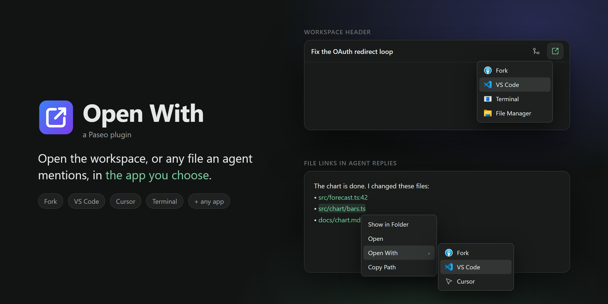
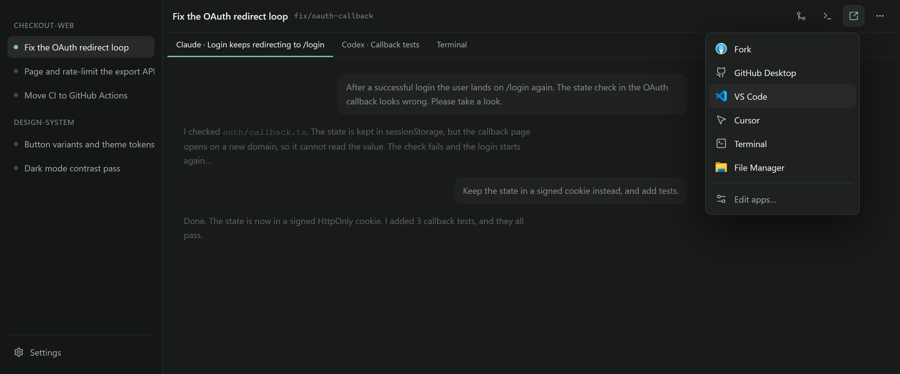
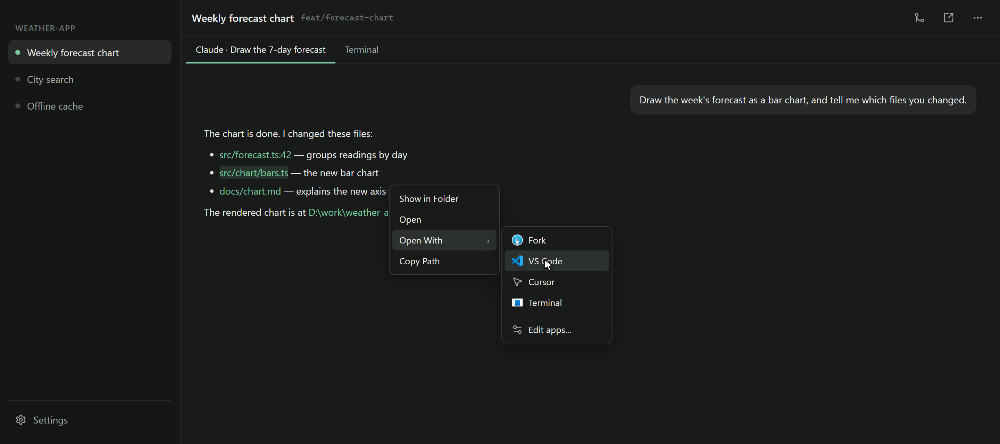
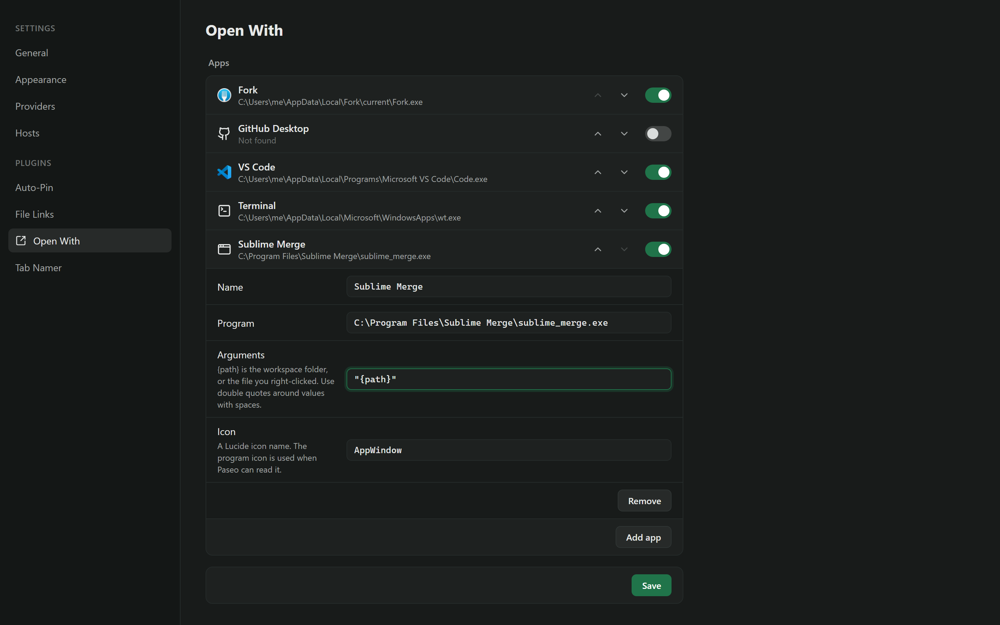
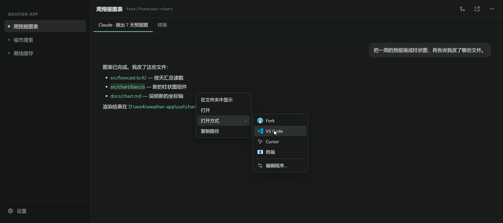

# Open With for Paseo

A [Paseo](https://paseo.sh) plugin that opens the workspace folder, or a file
link in an agent reply, in another app.



Paseo's own "Open in" button has a fixed list of editors, and you cannot add an
app such as Fork. Open With has a menu that you can change: add any program, turn
apps off, and put them in your order. The same list is in the right-click menu of
file links and images in agent replies.

Open With 0.2 includes the File Links plugin. If you have File Links, remove it
(see [Move from File Links](#move-from-file-links)).

## Install

Requires **Paseo 0.13.2 or later**.

```bash
paseo plugin install https://github.com/stv1024/paseo-open-with
```

If the button or the menu does not show, reload the Paseo window (**Ctrl+R**, or
**Cmd+R** on macOS).

## Open the workspace

Click the button in the workspace header, then click an app.



Built-in apps:

| App | Windows | macOS | Linux |
| --- | --- | --- | --- |
| Fork | `%LOCALAPPDATA%\Fork` | `/Applications/Fork.app` | - |
| GitHub Desktop | `%LOCALAPPDATA%\GitHubDesktop` | `/Applications/GitHub Desktop.app` | `github-desktop` |
| VS Code | user or system install, or `code` | `/Applications/Visual Studio Code.app`, or `code` | `code` |
| Cursor | user or system install, or `cursor` | `/Applications/Cursor.app`, or `cursor` | `cursor` |
| Terminal | Windows Terminal (`wt`) | Terminal.app | `x-terminal-emulator`, `gnome-terminal`, `konsole` |
| File Manager | File Explorer | Finder | `xdg-open` |

The menu shows only the apps it finds. Apps on `PATH` are found too.

## Open a file link

Right-click a local file link in an agent reply:

| Item | What it does |
| --- | --- |
| **Show in Folder** | Opens File Explorer or Finder with the file or folder selected. |
| **Open** | Opens the file with its default app, or opens the folder. |
| **Open With ›** | Opens the file in an app from your list. |
| **Copy Path** | Copies the absolute path. |



In **Open With ›**, each app gets what it can use:

| App | Gets |
| --- | --- |
| Fork, GitHub Desktop | the git repository that holds the file |
| Terminal | the folder that holds the file |
| VS Code, Cursor, and apps you add | the file itself |

Right-click an image in an agent reply to get **Copy Image** too. The file items
show only when the image comes from a local file.

Left-click keeps Paseo's own behavior. To get the browser menu instead, hold
**Shift** (or any other modifier key) while you right-click.

### Supported links

- Windows paths: `D:\work\report.md`, `\\server\share\a.txt`
- `file://` URLs
- Absolute POSIX paths: `/home/me/a.md`
- Home paths: `~/notes.md`
- Paths relative to the workspace: `src/app.ts`

Line suffixes such as `:42`, `:42:7`, `(42,7)` and `#L42` are ignored, so the menu
acts on the file. Web links (`https://…`, `mailto:`) keep the normal menu.

If the file does not exist, the menu shows **File not found** and keeps
**Copy Path** available. Images that an agent reads are often temporary copies, so
**Show in Folder** can open a temp folder.

## Add an app

Choose **Edit apps…** at the bottom of either menu. Then choose **Add app** and
fill in:

| Field | Example |
| --- | --- |
| Program | `C:\Program Files\Sublime Merge\sublime_merge.exe` |
| Arguments | `"{path}"` |
| Name | `Sublime Merge` |
| Icon | a [Lucide](https://lucide.dev/icons) icon name, used when Paseo cannot read the program icon |

`{path}` is the workspace folder, or the file you right-clicked. Arguments split
on spaces. Double quotes keep a value with spaces together, and backslashes stay
as they are. `%VAR%` (Windows) and a leading `~` in the program path are expanded.
A program name without a folder is looked up on `PATH`.

To change a built-in app, click it and fill in only the fields to change. **Reset**
returns it to the defaults.

Settings are saved per daemon, so each computer keeps its own list.



## How it works

The daemon finds the apps, reads their icons (Windows only), and starts the app.
So the app opens on the computer that runs the daemon, not on a remote client.
A launch error shows as a toast in the header menu, and in the right-click menu.

On Linux, **Show in Folder** asks the file manager to select the file through
D-Bus (`org.freedesktop.FileManager1`). When no file manager answers, it opens the
folder.

The right-click menu works in the desktop and web apps. The mobile app has no
right-click. Both menus follow Paseo's app language. Simplified Chinese is
translated; other languages show English.



## Move from File Links

File Links (`file-links`) is now part of Open With. To move:

```bash
paseo plugin remove file-links
paseo plugin install https://github.com/stv1024/paseo-open-with   # or: paseo plugin update open-with
```

Remove File Links, or every file link gets two right-click menus.

## Update

```bash
paseo plugin update open-with --check
paseo plugin update open-with
```

## Develop

```bash
npm install
npm run typecheck
npm test
paseo plugin install .
```

Run `paseo plugin reload open-with` after each change.

The images in `docs/images` are rendered from the HTML mockups in
`docs/media-src`: `node docs/media-src/render.mjs`. The script uses Chrome Headless
Shell when Playwright has installed it (`npx playwright install chromium --only-shell`),
and a local Chrome or Edge when not. On Windows, prefer the Shell: full Chrome can
check the Windows account password when it creates a new profile.

### Release

Releases go to npm as `paseo-open-with` through
[`.github/workflows/release.yml`](.github/workflows/release.yml), with npm Trusted
Publishing (no npm token). Bump `version` in `package.json`, add a `CHANGELOG.md`
section, then commit, tag and push:

```bash
npm run typecheck && npm test && npm run pack:npm   # check the packed file list
git push origin main
git tag -a v0.2.0 -m "Open With 0.2.0" && git push origin v0.2.0
```

The tag push publishes the tarball. Then create the GitHub release from the tag.
The official registry opens a bump PR for each new npm version.

## License

MIT
